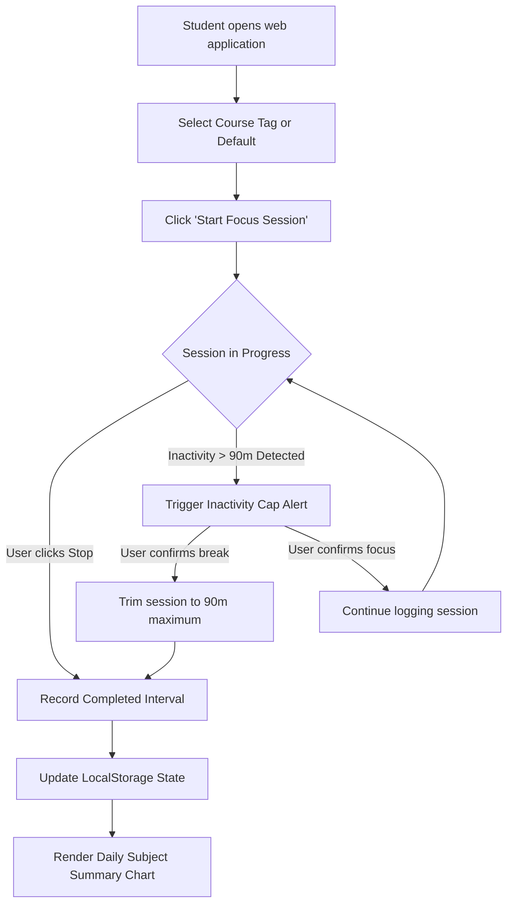

# System Requirements Specification (v1 Draft)

## 1. Context & Scope

- **Target User**: Gonzaga University undergraduate students balancing multiple demanding courses.
- **Problem Statement**: Existing productivity and time-tracking tools (such as Toggl Track, Notion, and complex spreadsheets) demand too much configuration, manual categorization, and continuous management. When students inevitably forget to stop running timers or get overwhelmed by setup overhead, their data breaks and they abandon tracking altogether within a week.
- **System Goal**: Provide a lightweight, zero-login study time tracker that logs focused intervals in a single click, prevents corrupt data via automatic session caps and idle timeouts, and gives students instant daily accountability without data entry fatigue.

---

## 2. Functional Requirements (FR)

- **FR-1 (Single-Click Interval Tracking)**: The user must be able to start, pause, and stop a focused study block with a single click or keyboard shortcut (`Spacebar`).
- **FR-2 (Course / Subject Categorization)**: The user must be able to select or quickly create an academic course tag (e.g., "BMIS 301", "Biol 205") with a color code before or during an active session.
- **FR-3 (Idle Detection & Safety Cap)**: If a continuous session exceeds 90 minutes without user interaction or if the tab is inactive for over 30 minutes, the system shall prompt the user to confirm whether they were studying or auto-cap the session to prevent corrupted time tallies.
- **FR-4 (Local Persistence & Recovery)**: Session records and active timer states must persist automatically in browser storage (`localStorage`) so that refreshing the page or closing the browser does not lose ongoing or past session history.
- **FR-5 (Daily & Weekly Visual Summary)**: The system shall present a clean dashboard showing total study hours logged today, broken down by subject, with zero manual spreadsheet calculation.
- **FR-6 (Data Export)**: The user must be able to export their session history to a CSV file at any time for personal records or instructor study-hall verification.

---

## 3. Non-Functional Requirements (NFR)

- **NFR-1 (Frictionless Onboarding)**: The application shall load in under 1.0 second on standard campus Wi-Fi and require zero account creation or sign-in for core tracking functionality.
- **NFR-2 (Responsive & Accessible UI)**: The interface must be completely accessible on both desktop laptops and mobile browsers, supporting standard screen readers and high-contrast dark/light color modes.
- **NFR-3 (Data Privacy & Zero Tracking)**: No personal identifiable information (PII), academic records, or telemetry data shall be collected or transmitted to external third-party servers.
- **NFR-4 (Robust Error Handling)**: Timer operations must handle clock adjustments, sleep-mode wakeups, and tab throttling without drift or crashing the application state.

---

## 4. User Interaction Flow

